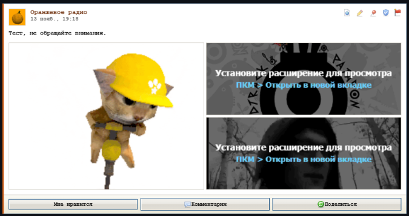
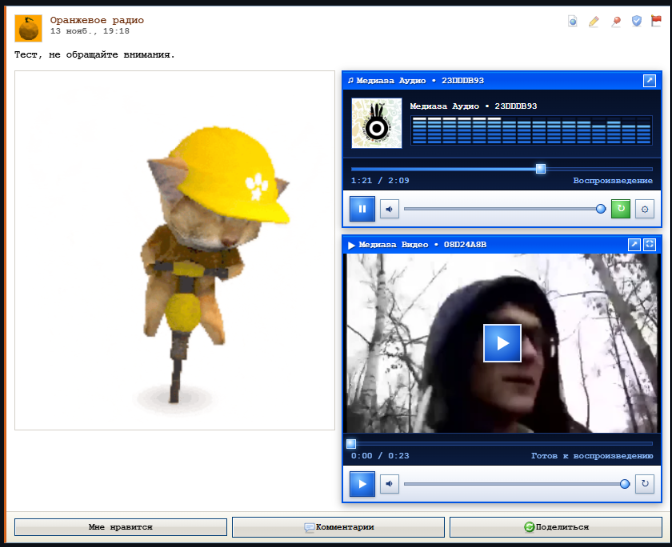
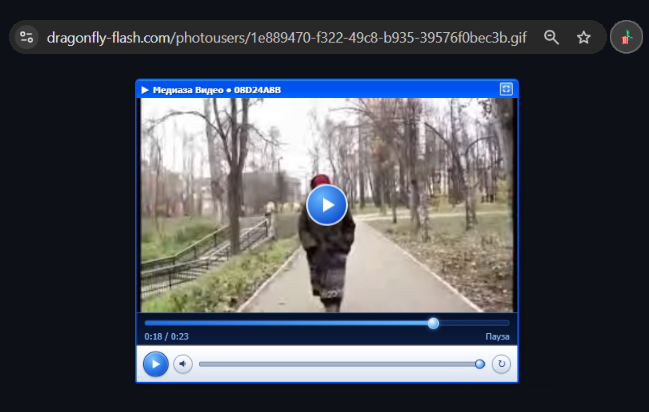

Расширение для Chrome (Manifest V3), позволяющее публиковать и воспроизводить **видео со звуком** и **аудиозаписи** в соцсети **Стрекоза** (`dragonfly-flash.ru` / `dragonfly-flash.com`), упаковывая медиафайл внутрь обычной `.gif`-картинки.

Работает полностью локально в браузере — без внешних серверов и сторонних библиотек.

---

## Скриншоты

### Пост в ленте без замены (как его видят пользователи без расширения или при выключенной галочке)


### Тот же пост с включённой заменой на встроенные плееры


### Просмотр видео по прямой ссылке (в новой вкладке)


---

## Возможности

### Встроенный плеер в стиле Windows XP / Стрекоза FM
* **Работает в ленте, в окне просмотра поста (Lightbox) и по прямой ссылке** (через `ПКМ → Открыть в новой вкладке` — работает всегда, даже если автоподмена в ленте отключена).
* **Мгновенная перемотка:** при загрузке плеера выполняется быстрая фоновая пред-индексация WebM, поэтому длительность видна сразу и можно перематывать в любую точку даже на паузе.
* **Двойная обложка (`DFGIF2`):** для пользователей без расширения 1-й кадр GIF может содержать водяной знак с инструкцией, а внутри файла хранится отдельная чистая обложка без текста — именно она отображается на заставке видеоплеера и в миниатюре аудиоплеера.
* **4 аудио-визуализатора (`⚙` возле кнопки повтора):**
  * Столбики (с падающими пиками)
  * Волна (осциллограф)
  * Зеркальный спектр
  * LED-матрица
* **4 режима чувствительности (частотной фильтрации) для всех визуализаторов:**
  * Стандартная
  * Виртуальный основной тон (разностные тоны Тартини)
  * Высокий тон
  * Низкий тон

### Студия конвертации и база (`IndexedDB`)
* **Видео → GIF:** сжатие до QVGA (`320×240`) со звуком (`WebM VP8/VP9 + Opus`), настройка FPS и битрейта.
* **Аудио → GIF:** упаковка готового аудио мгновенно без пережатия или сжатие в `Opus` (`24–64 кбит/с`).
* **Настройка обложки:** кадр из видео, своя картинка или заглушка; опциональный водяной знак и свой текст под ним.
* **Хранение:** сохранённые GIF можно просматривать, скачивать (`.gif`) и удалять как в самой студии, так и через popup-окно расширения.

---

## Установка

1. Скачайте репозиторий (кнопка **Code → Download ZIP** и распакуйте архив, либо через `git clone`):
   ```bash
   git clone https://github.com/oorraanngee/Mediaza.git
   ```
2. Откройте в Chrome страницу `chrome://extensions/`.
3. Включите **режим разработчика** (переключатель в правом верхнем углу).
4. Нажмите **загрузить распакованное расширение** и выберите папку `chrome` из корня проекта.

## Как это устроено
Сервер Стрекозы пересжимает статичные изображения (PNG/JPG/WebP) в JPEG, уничтожая любые дописанные данные, однако файлы `.gif` сохраняются с кадрами без потерь:
1. **1-й кадр GIF** — статичная обложка (квантованная в 256 цветов) с максимальной задержкой показа и серией лёгких `1×1` кадров удержания, чтобы без расширения картинка не мигала.
2. **Последующие кадры** — бинарные данные медиафайла и чистой обложки, закодированные в 64-цветную палитру (6 бит на пиксель) с заголовком `DFGIF2`, уникальным ID и проверкой целостности `CRC32`.
3. Расширение находит `.gif`-вложения на странице, считывает `LZW`-кадры напрямую из бинарного файла, проверяет `CRC32` и подменяет картинку на плеер.
